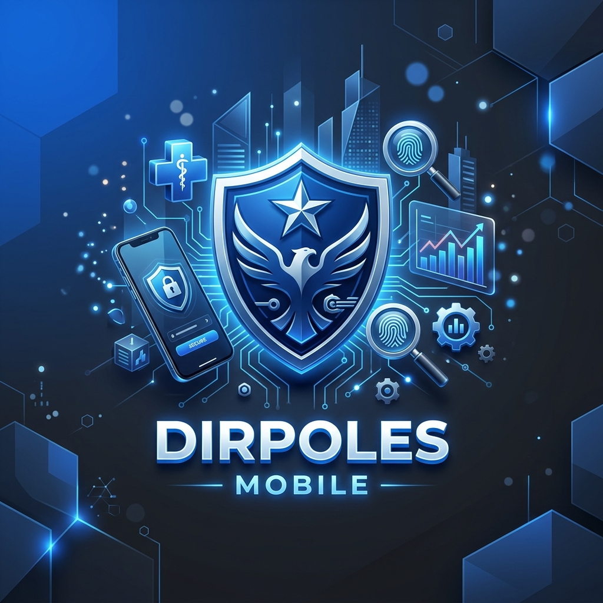
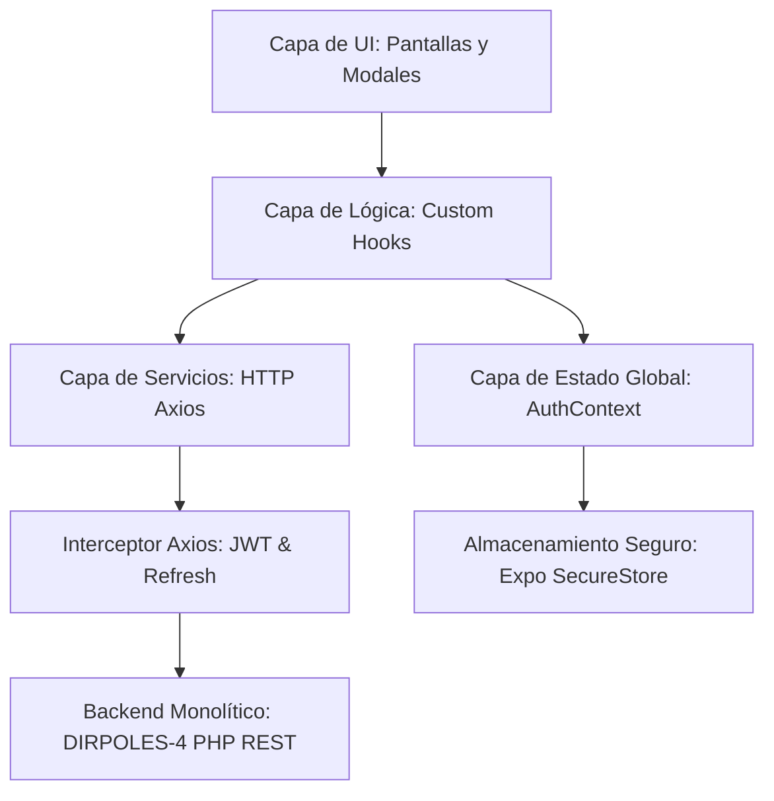

<div align="center">

  # 🛡️ DIRPOLES Mobile

  **Sistema Integral de Gestión Móvil para la Dirección de Políticas Estudiantiles**  
  *Universidad Politécnica Territorial Andrés Eloy Blanco (UPTAEB)*

  <p align="center">
    <a href="#-características-principales">Características</a> •
    <a href="#-arquitectura-del-sistema">Arquitectura</a> •
    <a href="#-guía-de-instalación-y-puesta-en-marcha">Instalación</a> •
    <a href="#-guía-de-pruebas-paso-a-paso">Guía de Pruebas</a> •
    <a href="#-solución-de-problemas">Troubleshooting</a> •
    <a href="#-estructura-del-proyecto">Estructura</a>
  </p>

  <p align="center">
    
    
    
    
    
  </p>

  

</div>

---

## 📋 Descripción General

**DIRPOLES Mobile** es la aplicación móvil oficial diseñada para modernizar, agilizar y centralizar las operaciones de la **Dirección de Políticas Estudiantiles (DIRPOLES)** en la UPTAEB. 

Construida bajo los estándares de una **Arquitectura en Capas Desacoplada** y principios **SOLID**, la aplicación proporciona a médicos, psicólogos y directivos una herramienta de alta confiabilidad para gestionar la atención estudiantil, optimizar el control de citas, auditar el inventario médico en tiempo real y emitir reportes formales en formato PDF.

---

## ✨ Características Principales

* **🔐 Seguridad de Nivel Corporativo**:
  * Cifrado asimétrico **RSA (Base64)** de credenciales en el cliente antes de ser enviadas a la red.
  * Autenticación basada en **JWT** con rotación y refresco transparente mediante `Axios Interceptors`.
  * Almacenamiento seguro por hardware mediante **`Expo SecureStore`** (sin uso de almacenamiento no seguro en texto plano).
* **🛡️ Control de Acceso Basado en Roles (RBAC)**:
  * Restricciones de pantalla automáticas según el perfil del empleado (**Administrador**, **Médico**, **Psicólogo**).
  * Intercepción con modales amigables (`CustomModal`) ante accesos no autorizados.
* **👥 Gestión de Beneficiarios**:
  * Paginación y búsqueda instantánea por cédula, nombres o apellidos.
  * Formularios modales con validación en vivo contra duplicados en la base de datos (cédula, correo y teléfono).
* **📅 Agenda Médica y Psicológica Inteligente**:
  * Calendario interactivo integrado en español (`react-native-calendars`).
  * Validación automática de turnos, jornadas de trabajo del especialista y disponibilidad de bloques horarios.
* **📦 Inventario Médico e Insumos**:
  * Catálogo de fármacos y materiales con alertas visuales de **stock bajo** o agotado.
  * Control de lotes, fechas de caducidad y presentaciones.
* **📊 Reportes Avanzados y Exportación a PDF**:
  * Métricas visuales e indicadores consolidados por módulo.
  * Filtros multicriterio: rango de fechas, género, PNF/carrera universitaria, estado de citas y categorías de insumos.
  * Generación y compartición nativa de reportes en PDF con diseño corporativo institucional vía `expo-print` y `expo-sharing`.

---

## 🏛️ Arquitectura del Sistema

El proyecto sigue una estricta separación de responsabilidades para garantizar mantenibilidad, testing aislado y escalabilidad:



### Stack Tecnológico

| Componente | Tecnología | Versión / Detalle |
| :--- | :--- | :--- |
| **Framework Base** | [React Native](https://reactnative.dev/) / [Expo](https://expo.dev/) | Expo SDK 52+ / React Native 0.86 |
| **Diseño / UI Kit** | [React Native Paper](https://reactnativepaper.com/) | v5.15+ (Material Design 3) |
| **Iconografía** | [Lucide React Native](https://lucide.dev/) | Iconos SVG vectoriales limpios |
| **Navegación** | [React Navigation](https://reactnavigation.org/) | v6 (Stack Navigator + Bottom Tabs) |
| **HTTP Client** | [Axios](https://axios-http.com/) | Interceptores de request y response |
| **Cifrado RSA** | [JSEncrypt](https://github.com/travist/jsencrypt) | Cifrado asimétrico en cliente |
| **Reportes PDF** | `expo-print` + `expo-sharing` | Compilación y compartición nativa de PDF |

---

## 🛠️ Guía de Instalación y Puesta en Marcha

Sigue detenidamente estos pasos para clonar, configurar y ejecutar la aplicación en tu entorno local.

### 1. Requisitos Previos

Antes de comenzar, asegúrate de tener instalado en tu computadora de desarrollo:

1. **Node.js**: Versión **18.x** o superior (recomendado Node.js LTS).
   ```bash
   node -v
   npm -v
   ```
2. **Git**: Instalado y configurado en tu sistema.
3. **Dispositivo o Emulador de Pruebas**:
   * **Opción A (Recomendada - Dispositivo Físico)**: Instala la app **Expo Go** desde [Google Play Store](https://play.google.com/store/apps/details?id=host.exp.exponent) (Android) o [Apple App Store](https://apps.apple.com/app/expo-go/id982107779) (iOS).
   * **Opción B (Emulador Android)**: Configurado en Android Studio con aceleración por hardware.
4. **Backend DIRPOLES-4**:
   * Servidor Apache/PHP y MySQL (ej. **XAMPP**, **Laragon** o **LAMP**) ejecutando el backend **`DIRPOLES-4`**.
   * Base de datos migrada con datos de prueba.

---

### 2. Clonar el Repositorio

Abre una terminal y clona el código fuente:

```bash
git clone https://github.com/dirpoles/DIRPOLES_APP.git
cd DIRPOLES_APP
```

---

### 3. Instalar Dependencias

Instala los paquetes de Node mediante `npm`:

```bash
npm install
```

> [!NOTE]
> Si en el futuro instalas nuevas librerías que requieran módulos nativos de Expo, utiliza siempre `npx expo install <nombre-paquete>` para garantizar la compatibilidad exacta con la versión del SDK instalada.

---

### 4. Configurar la Conexión con el Backend

La aplicación necesita comunicarse con la API de **DIRPOLES-4**. Toda la configuración de red reside en el archivo:
[`src/constants/config.js`](file:///home/roberth/Proyectos/DIRPOLES_APP/src/constants/config.js).

Abre el archivo y actualiza la constante `BASE_URL` según tu entorno:

```javascript
// src/constants/config.js

/**
 * URL base del servidor backend DIRPOLES-4.
 * Reemplaza la IP por la dirección correspondiente a tu entorno.
 */
export const BASE_URL = 'http://TU_IP_LOCAL/DIRPOLES-4';

/**
 * Prefijo de la API REST para los módulos.
 */
export const API_URL = `${BASE_URL}/api`;
```

#### ¿Qué dirección IP debes colocar en `BASE_URL`?

Selecciona el caso que corresponda a tu escenario de desarrollo:

#### Caso A: Dispositivo Físico (Teléfono por Wi-Fi) — *Recomendado*
El teléfono y la computadora **deben estar conectados a la misma red Wi-Fi**.
1. En tu computadora, obtén tu dirección IP local:
   * **Linux / macOS**: ejecuta `ip a` o `ifconfig` (ejemplo: `192.168.1.100` o `192.168.50.100`).
   * **Windows**: ejecuta `ipconfig` en CMD y busca la *Dirección IPv4* de tu adaptador Wi-Fi.
2. Configura en `src/constants/config.js`:
   ```javascript
   export const BASE_URL = 'http://192.168.1.100/DIRPOLES-4';
   ```
3. > [!IMPORTANT]
   > **Nunca uses `localhost` o `127.0.0.1`** si vas a probar en un teléfono físico, ya que el teléfono intentará conectarse a sí mismo y arrojará error de red.

#### Caso B: Emulador de Android (Android Studio)
Los emuladores de Android usan una red interna virtual:
```javascript
export const BASE_URL = 'http://10.0.2.2/DIRPOLES-4';
```
*(La IP `10.0.2.2` apunta al `localhost` de la máquina anfitriona).*

#### Caso C: Simulador de iOS (macOS)
El simulador de iOS comparte la misma interfaz de red de tu Mac:
```javascript
export const BASE_URL = 'http://localhost/DIRPOLES-4';
```

---

### 5. Sincronización de Claves de Cifrado RSA

Para garantizar que el inicio de sesión no transmita contraseñas en texto plano:
* La aplicación móvil cifra la clave del usuario con la clave pública contenida en [`src/config/rsaKeys.js`](file:///home/roberth/Proyectos/DIRPOLES_APP/src/config/rsaKeys.js).
* Si tu instancia del backend utiliza un par de llaves propio (`login_public.pem` y `login_private.pem`), asegúrate de copiar el contenido exacto de tu clave pública en:

```javascript
// src/config/rsaKeys.js
export const RSA_PUBLIC_KEY = `-----BEGIN PUBLIC KEY-----
MIIBIjANBgkqhkiG9w0BAQEFAAOCAQ8AMIIBCgKCAQEA1lZipHO91W8RN/OYYoGz
... (tu clave pública RSA PEM) ...
-----END PUBLIC KEY-----
`;
```

---

### 6. Ejecutar la Aplicación

Inicia el empaquetador Metro de Expo:

```bash
npx expo start
```

Opciones de ejecución útiles:

```bash
# Iniciar limpiando la caché de empaquetado (recomendado tras cambios de config)
npx expo start -c

# Iniciar directamente con emulador de Android conectado
npm run android

# Iniciar usando modo Túnel (ideal si tu router bloquea tráfico local entre dispositivos)
npx expo start --tunnel
```

#### Conectar tu Dispositivo:
1. En la consola aparecerá un **código QR**.
2. **Android**: Abre la app **Expo Go**, presiona *"Scan QR Code"* y enfoca la terminal.
3. **iOS**: Abre la aplicación nativa de **Cámara**, apunta al código QR y toca la notificación emergente de Expo.

---

## 🧪 Guía de Pruebas Paso a Paso

Una vez que la aplicación cargue en tu dispositivo, sigue esta secuencia de verificación para confirmar que todo funcione al 100%:

### Paso 1: Verificación de Conectividad de Red
Antes de abrir la app, abre el navegador web de tu teléfono móvil e ingresa la URL de tu backend:
```text
http://TU_IP_LOCAL/DIRPOLES-4/api/perfil/obtener
```
* **Resultado Esperado**: El navegador debe responder con un JSON de error de autenticación (ej. `{"exito": false, "error": ...}`) o cargar la página del servidor.
* **Si el navegador se queda cargando o dice "Tiempo de espera agotado"**: Revisa tu Firewall o asegúrate de que ambos dispositivos estén en la misma red Wi-Fi.

---

### Paso 2: Prueba de Autenticación y Cifrado
1. En la pantalla de **Login**, introduce el correo y contraseña de un usuario registrado en tu base de datos.
2. Presiona **"Iniciar Sesión"**.
3. **Validaciones automáticas del sistema**:
   * La app valida el formato de correo y longitud de contraseña mínima (6 caracteres).
   * La contraseña se cifra con RSA en milisegundos.
   * Al recibir la respuesta exitosa, los tokens JWT y de refresco se guardan en el almacenamiento cifrado del dispositivo (`SecureStore`).
   * Serás redirigido automáticamente al **Dashboard**.

---

### Paso 3: Prueba de Control de Acceso por Roles (RBAC)
La aplicación implementa una matriz de permisos estricta:

| Rol de Usuario | Inicio | Beneficiarios | Citas (Psicología) | Inventario (Medicina) | Reportes | Perfil |
| :--- | :---: | :---: | :---: | :---: | :---: | :---: |
| **Superusuario / Admin** |  |  |  |  |  |  |
| **Médico** |  |  | ❌ *(Bloqueado)* |  |  |  |
| **Psicólogo** |  |  |  | ❌ *(Bloqueado)* |  |  |

**Cómo probar la restricción**:
1. Inicia sesión con una cuenta de **Médico**:
   * Toca la pestaña **"Citas"**.
   * Debe aparecer inmediatamente un diálogo `CustomModal` indicando: *"Acceso Restringido: No tienes permisos para acceder al módulo de Citas..."*.
2. Inicia sesión con una cuenta de **Psicólogo**:
   * Toca la pestaña **"Inventario"**.
   * Debe aparecer el modal bloqueando el acceso.

---

### Paso 4: Prueba del Módulo de Beneficiarios
1. Dirígete a la pestaña **Beneficiarios**.
2. Escribe una cédula o nombre en la barra de búsqueda para verificar el filtrado en tiempo real.
3. Toca el botón flotante **"+"** para abrir el formulario de registro:
   * Ingresa una cédula ya registrada en el sistema.
   * El sistema validará en segundo plano contra el backend y mostrará un mensaje de alerta por duplicado antes de permitir registrar.

---

### Paso 5: Prueba de Citas y Calendario
1. Ingresa a **Citas** (con rol Admin o Psicólogo).
2. Selecciona una fecha en el calendario interactivo.
3. Abre el formulario de agendamiento:
   * Selecciona el beneficiario y el especialista.
   * La app consultará los horarios de trabajo del especialista y bloqueará los bloques de hora que ya estén ocupados.

---

### Paso 6: Prueba de Reportes y Exportación a PDF
1. Ingresa a la pestaña **Reportes**.
2. Selecciona un módulo (ej. *Citas* o *Beneficiarios*).
3. Aplica filtros multicriterio (por fechas, género, estado o PNF).
4. Toca el botón **"Generar Reporte PDF"**:
   * El cliente compilará un documento formal con encabezados de la institución, resumen ejecutivo y tablas de datos.
   * Se abrirá el selector nativo del sistema operativo (`expo-sharing` / `expo-print`) permitiéndote previsualizar, imprimir o compartir el PDF generado.

---

### Paso 7: Prueba de Cierre de Sesión
1. Presiona el ícono de cerrar sesión en la esquina superior derecha.
2. Se desplegará el diálogo modal de confirmación (`CustomModal`).
3. Al confirmar, los tokens y datos de usuario serán eliminados de `SecureStore` y la aplicación volverá de forma limpia a la pantalla de Login.

---

## 🔧 Solución de Problemas Frecuentes (Troubleshooting)

### 1. `Error: No se pudo conectar con el servidor` al intentar iniciar sesión
* **Causa 1**: La dirección IP en `BASE_URL` cambió (los routers suelen reasignar IPs locales por DHCP al reconectar).
  * *Solución*: Ejecuta `ip a` o `ipconfig` y actualiza la IP en `src/constants/config.js`.
* **Causa 2**: El firewall de tu computadora está bloqueando las peticiones entrantes al puerto 80 / Apache.
  * *Solución en Windows*: Ve a *Firewall de Windows Defender* > *Permitir que una aplicación se comunique...* > Marca **Apache HTTP Server** en redes Privadas y Públicas.
  * *Solución en Linux*: Ejecuta `sudo ufw allow 80/tcp` o desactiva temporalmente el firewall para descartar.
* **Causa 3**: Tu teléfono está usando datos móviles en lugar del Wi-Fi donde está el servidor.

---

### 2. `Error: Correo o contraseña incorrectos` a pesar de ingresar credenciales válidas
* **Causa**: La clave pública RSA en `src/config/rsaKeys.js` no coincide con la clave privada configurada en el backend `DIRPOLES-4`.
  * *Solución*: Revisa que el backend y la app compartan exactamente el mismo par de claves RSA.

---

### 3. La app no refleja cambios en el código o variables
* Metro Bundler a veces almacena en caché la configuración anterior.
* *Solución*: Detén la terminal (`Ctrl + C`) y reinicia con el flag de limpieza de caché:
  ```bash
  npx expo start -c
  ```

---

### 4. Errores de dependencias o de Node al ejecutar `npm install`
* Si tienes conflictos de versiones con React 19 o Expo SDK:
  ```bash
  npm install --legacy-peer-deps
  ```

---

## 📂 Estructura del Repositorio

```text
DIRPOLES_APP/
├── assets/                     # Recursos gráficos (iconos, splash, banners)
│   ├── images/
│   │   └── banner.png          # Banner visual corporativo
│   ├── adaptive-icon.png
│   ├── icon.png
│   └── splash.png
├── src/                        # Código fuente modular
│   ├── components/             # Componentes de presentación reutilizables
│   │   ├── Beneficiarios/      # Tarjetas, modales y listas de beneficiarios
│   │   ├── Citas/              # Calendarios, tarjetas y formularios de citas
│   │   ├── Inventario/         # Componentes de stock y alertas de insumos
│   │   └── UI/                 # CustomModal, inputs y componentes compartidos
│   ├── config/
│   │   └── rsaKeys.js          # Clave pública RSA para cifrado en cliente
│   ├── constants/
│   │   └── config.js           # BASE_URL, API_URL, paleta COLORS y timeouts
│   ├── context/
│   │   └── AuthContext.js      # Estado global de sesión (user, login, logout)
│   ├── hooks/                  # Custom Hooks con lógica de negocio (SOLID)
│   │   ├── useBeneficiarioForm.js
│   │   ├── useCitaForm.js
│   │   ├── useLoginForm.js
│   │   ├── useInventarioList.js
│   │   └── useReportes.js
│   ├── navigation/             # Enrutamiento y control de flujo
│   │   ├── AppNavigator.js     # Switch entre flujo no autenticado vs autenticado
│   │   └── TabNavigator.js     # Menú inferior por pestañas y filtro RBAC
│   ├── screens/                # Vistas principales de la aplicación
│   │   ├── auth/LoginScreen.js
│   │   ├── Dashboard/HomeScreen.js
│   │   ├── beneficiarios/BeneficiariosScreen.js
│   │   ├── citas/CitasScreen.js
│   │   ├── inventario/InventarioScreen.js
│   │   ├── perfil/PerfilScreen.js
│   │   └── reportes/ReportesScreen.js
│   ├── services/               # Consumo de API REST (Axios)
│   │   ├── api.js              # Instancia de Axios con interceptores JWT
│   │   ├── authService.js      # Servicio de autenticación y sesión
│   │   ├── beneficiarioService.js
│   │   ├── citaService.js
│   │   ├── inventarioService.js
│   │   ├── perfilService.js
│   │   └── reporteService.js
│   └── utils/                  # Funciones de soporte puras
│       ├── permissions.js      # Matriz de permisos RBAC por rol de usuario
│       ├── rsaEncrypt.js       # Algoritmo de cifrado RSA
│       └── validators.js       # Validaciones de cédula, email y formato
├── App.js                      # Raíz de la app (Providers de Context y Paper)
├── app.json                    # Manifiesto y configuración de Expo SDK
├── package.json                # Lista de dependencias y scripts npm
└── README.md                   # Documentación principal del repositorio
```

---

## 🔒 Matriz de Endpoints Consumidos

La aplicación móvil consume los siguientes endpoints expuestos por el backend **`DIRPOLES-4`**:

| Módulo | Acción en la App | Método | Endpoint Backend |
| :--- | :--- | :---: | :--- |
| **Auth** | Iniciar Sesión | `POST` | `/iniciar_sesion` |
| **Auth** | Refrescar Token | `POST` | `/refresh_token` |
| **Auth** | Cerrar Sesión | `GET` | `/logout` |
| **Perfil** | Consultar Datos de Usuario | `GET` | `/api/perfil/obtener` |
| **Perfil** | Actualizar Datos / Clave | `PUT` | `/api/perfil/actualizar` |
| **Beneficiarios** | Listar / Filtrar | `GET` | `/api/beneficiarios/listar` |
| **Beneficiarios** | Validar Duplicado | `POST` | `/api/beneficiarios/validar_duplicado` |
| **Beneficiarios** | Registrar Beneficiario | `POST` | `/api/beneficiarios/crear` |
| **Beneficiarios** | Actualizar Beneficiario | `PUT` | `/api/beneficiarios/actualizar/{id}` |
| **Citas** | Consultar Agenda | `GET` | `/api/citas/listar` |
| **Citas** | Crear Cita | `POST` | `/api/citas/crear` |
| **Citas** | Cambiar Estado de Cita | `PUT` | `/api/citas/cambiar_estado` |
| **Inventario** | Consultar Insumos | `GET` | `/api/inventario/listar` |
| **Inventario** | Registrar Movimiento | `POST` | `/api/inventario/registrar_movimiento` |
| **Reportes** | Indicadores Estadísticos | `GET` | `/api/reportes/indicadores` |

---

## 📄 Licencia

Este proyecto es propiedad institucional de la **Dirección de Políticas Estudiantiles de la Universidad Politécnica Territorial Andrés Eloy Blanco (UPTAEB)**. Todos los derechos reservados.

---

<div align="center">
  <sub>Desarrollado y mantenido para la Dirección de Políticas Estudiantiles — UPTAEB</sub>
</div>
